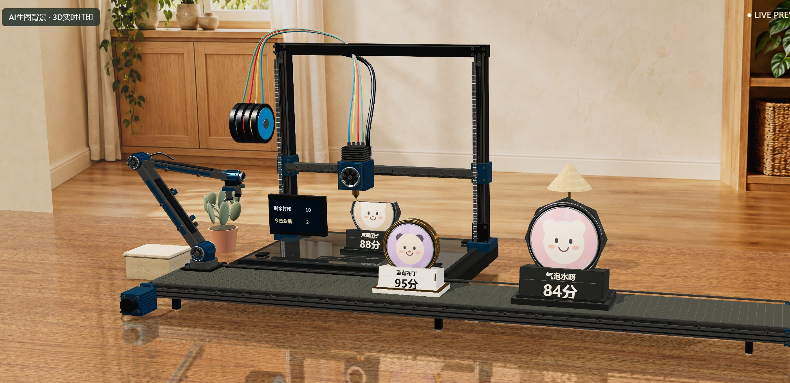
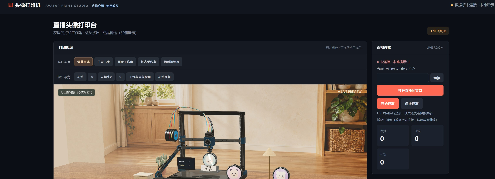
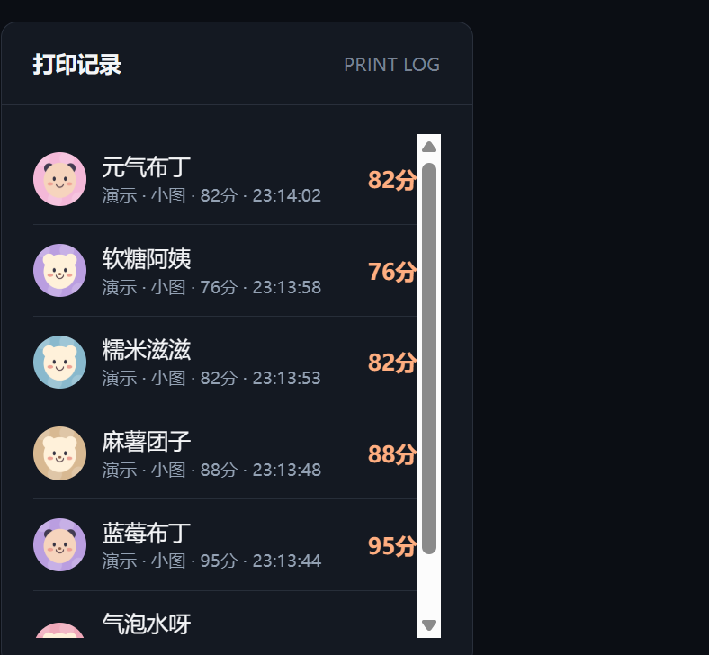
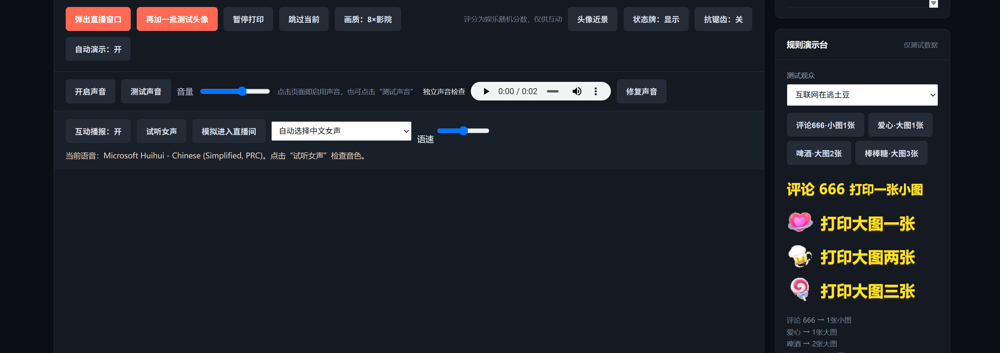

# 头像打印机

> **3D打印机开源直播抖音快手tiktok直播项目** —— 志哥AI 出品。
> **开源免费声明：本软件完全开源、免费使用——可自由下载、安装、使用、修改与分享，无任何付费或授权限制。**

## 运行

### 环境要求

仅支持 **Windows 10 / 11（64 位）**：桌面壳基于 WebView2，语音播报用系统 SAPI，抖音数据桥通过本机浏览器的调试端口抓取弹幕。

| 组件 | 版本 | 用途 |
| --- | --- | --- |
| Python | 3.9 及以上（实测 3.12.10） | 桌面壳与本地 HTTP 服务 `launch.py` |
| pywebview | 5.0 及以上（实测 6.2.1） | 桌面窗口；5.0 起才有 `FileDialog` 和 `REMOTE_DEBUGGING_PORT` |
| WebView2 Runtime | 微软 Evergreen 运行时 | pywebview 的渲染内核；Win11 自带，Win10 多数已随 Edge 安装 |
| Node.js | 18 及以上（实测 24.11.1） | 只跑数据桥 `douyin-bridge.mjs`，仅用内置模块，无需 `npm install` |
| Edge 或 Chrome | 任意近期版本 | 网页版「直播间窗口」「独立场景窗口」和调试端口（9223 / 9222） |
| 中文语音 | Windows 自带 SAPI | 礼物与进场语音播报；系统默认嗓音即可 |
| OBS Studio | 自带浏览器源 | 采集 `live-view.html` 输出到直播伴侣，非本软件必需 |

安装依赖（只需 Python 这一项；Node.js 与 WebView2 Runtime 从官网装 MSI/开机自带的安装包）：

```bat
pip install "pywebview>=5"
```

- WebView2 Runtime：<https://developer.microsoft.com/microsoft-edge/webview2/>（Evergreen Bootstrapper）
- Node.js：<https://nodejs.org/>（LTS 即可）

### 启动

```bat
start.bat          :: 启动本地服务并打开桌面窗口（日常使用）
start-all.bat      :: 等同 start.bat（保留旧入口）
start-bridge.bat   :: 只启动数据桥，适合命令行单独跑；也可以在桌面窗口里点「开始抓取」
```

只想要网页版：`python launch.py --server-only`（无需 pywebview，仍需 Python 3.9+），再打开 http://127.0.0.1:8080 。必须通过 HTTP 访问，直接双击 HTML 会因 ES modules 限制得到空白页。Three.js、贴图、音效都在 `assets/`，演示头像由 Canvas 生成，首次运行不需要联网。端口固定：HTTP 8080、数据桥 WebSocket 8765、直播间调试 9224，被占用时启动会报错。

功能介绍见 http://127.0.0.1:8080/features.html ，完整使用教程见 http://127.0.0.1:8080/guide.html （打印台顶部也有入口）。本软件完全开源、免费使用，由 志哥AI 出品。

## 目录结构

```
index.html / index-en.html   主打印台（中文 / 英文，两版互不影响）
live-view.html               OBS 直播小窗：接收主画面并叠加规则牌、排队大屏、头像小镇
live.html                    1080×1920 竖屏直播窗口
features.html / guide.html   功能介绍 / 使用教程
assets/                      Three.js、PBR 贴图、音效、礼物图标
docs/screenshots/            README 预览图
scene-channel.mjs            页面间 BroadcastChannel + 本地 HTTP 中继
scene-output.mjs             渲染尺寸、画质档位与内部倍率
douyin-bridge.mjs            抖音弹幕数据桥（只读取公开弹幕，无第三方依赖）
bridge-ws.mjs                数据桥 WebSocket 服务
gift-speech.mjs / -en.mjs    中文 / 英文语音播报
printer-audio.mjs            打印音效
launch.py                    WebView2 桌面壳与本地 HTTP 服务
scene_relay.py               独立进程之间的信令中继
*.test.mjs                   离线单元测试（node --test）
```

> `ai-live.html`（AI 头像工坊）需要本机 8770 端口的 AI 服务与模型文件，仓库不包含模型；其余功能开箱即用。

## 界面预览

<p align="center">
  
  <br>
  
  
  
</p>

打开后自动加载 8 个测试头像，逐层打印、出分、转运到前方横向传送带。前方成品与后方打印并行运行。暂停同时冻结打印和流水线；跳过只丢弃当前打印中的物品。连续 30 秒没有任何观众消息时自动补一张测试头像（之后每 30 秒最多补一张、队列最多预留 2 张），有真实消息立刻让位。可拖动视角检查模型。画面上方有「镜头视角」栏：随时「＋保存当前视角」（最多10个命名镜头，点击切换、✕删除），**随手拖动的视角和上次使用的镜头都会自动记忆**，刷新/重开页面自动回到上次的机位；「初始视角」一键回到开机默认机位。画质下拉五档可选：极速低配（关反射/阴影/扫光特效，集显或采集时流畅不卡） / 标准 / 2×精细 / 4×超清 / 8×影院（渲染分辨率最高翻八倍，反射与阴影贴图同步升档，选择自动记忆）；「状态牌」按钮可显示/隐藏画面上的打印状态牌（同样记忆）。直播连接面板显示连接状态、直播间链接、点赞/评论/礼物实时计数与当前打印进度；打印记录面板记录每个已打印观众的昵称、头像、触发方式（评论/点赞/礼物）、大小、分数和时间。页面隐藏时打印由后台时钟继续推进，切回来自动恢复渲染。

## 真实直播接入（数据桥）

桌面窗口右侧「直播连接」面板里填房间号（或整条链接）→「打开直播间窗口」扫码登录 →「开始抓取」。直播间窗口是独立的 Chrome 配置，登录状态会记住，登录后头像抓取更全。也可以脱离桌面窗口，先用 start.bat 起服务，再用 start-bridge.bat 单独跑数据桥。

页面自动连接 ws://127.0.0.1:8765，右上角亮起「● 直播数据 · 数据桥已连接 · 房间号」。右上角「English / 中文」可切换中英双语版（英文版 index-en.html 为独立文件、独立英文语音 gift-speech-en.mjs，互不影响，可分别调试；两版同时打开时自动由其中一个接管打印，不重复）。英文版适合 TikTok（TK）直播场景。「🎬 独立场景窗口」按钮可把 3D 打印现场单独弹成一个纯画面窗口（无任何面板，适合 OBS 窗口采集或第二屏幕）：场景窗口打开时打印由它接管，主窗口只计数不重复打印，关闭场景窗口后主窗口自动恢复。直播连接面板底部有「打印规则」折叠区：评论/进场/点赞/关注/礼物是否打印、礼物语音播报、进场欢迎语音、30秒无互动补位共 8 个开关，勾选立即生效并本地记忆（默认只有评论打印）。数据桥自动跟随直播间：重新打开别的直播窗口或改动房间号，无需重启数据桥；「停止抓取」会同时停掉手动启动的数据桥。需要 Node.js。数据桥连接期间自动演示填充会自动关闭（只打印真实观众），断开后自动恢复；无论是否连接，只要连续 30 秒没有任何观众消息（评论/点赞/礼物/关注/进场），就会自动补入测试头像避免画面空转，真实消息一到立即恢复优先。打印画面可点「弹出直播窗口」单独弹出一个 1080×1920 竖屏直播窗。

数据桥从本机浏览器的直播间页面读取弹幕：优先自己的「直播间窗口」(:9223，可登录) → BrowserOS neo(:9110) → 已开调试端口的 Chromium(:9222)。每 0.3 秒采集一次，评论/礼物/点赞秒级触发打印；礼物插队最前，评论排在点赞之前，点赞高峰期约每 0.4 秒放行一张防刷屏。关闭桥窗口即停止采集（直播间窗口可手动关掉）。

事件映射（直播间左上角规则牌）：

- 评论（默认只认含 888 的发言，可在「打印规则 → 评论打印 → 只打印含」改成别的关键词或留空）→ 1 张小图（发评论也要排队）
- 点赞 → 按「本场点赞」增量，1 赞 1 张小图；抖音页面不公开点赞人，数据桥在累积观众花名册上交错轮换归属，**每个点赞都带真实昵称和头像**，同一人每轮最多 3 次，轮满全场再开新一轮，绝不匿名打印；轮换按活跃新鲜度优先，新观众进入花名册自动开启新一轮
- 关注 → 1 张大图（播报）；爱心/小心心 → 3 张大图；啤酒 → 1 张大图；玫瑰 → 10 张大图；棒棒糖 → 99 张大图（礼物插队不打断当前打印）
- 其他礼物 → 1 张大图；进场 → 播报欢迎不打印

头像获取（三层保障，实测实时评论 100% 带头像）：第一层为**协议级直读**——数据桥直接解码直播间 WebSocket 协议帧，每条评论/点赞/进场/关注/礼物消息和活跃观众榜单都自带头像，零点击、零延迟入库，并写入本地头像缓存（avatar-cache.json，跨重启、跨房间复用，回访观众秒出头像）；第二层为页面多来源采集——观众列表/贡献条/进出场记录滚动累积，弹幕昵称与面板昵称按归一化（去空格和装饰 emoji）模糊匹配；第三层为资料卡补取——仍未匹配到的观众自动点击昵称打开资料卡，每昵称最多 4 批、每批换 3 个点击位置（先弹幕区后全页查找），等头像图片读取完成，每批结束到评论区点一下关闭资料卡再换位置重试，同一昵称 4 秒后可再试；就算没人发言，每 45 秒也会自动给最近活跃、还没有头像的观众补点 2 次资料卡；都拿不到时自动生成彩色首字头像，不再是灰色占位人形。挂接前已滚过的历史弹幕不打印（其协议帧早已消失），只同步头像。评分为娱乐随机分数。页面与数据桥均只读取公开弹幕，不登录、不发弹幕、不赠送礼物。


## WebView2 桌面版
start.bat 和 start-all.bat 现在均启动独立 WebView2 应用。填写房间号，打开直播间窗口并登录，再点击开始抓取。停止抓取会停止本应用的数据桥；关闭主窗口会清理本应用启动的登录窗口和数据桥。首次使用请关闭旧版 ServerGuard、BridgeGuard 及旧数据桥，以免占用端口。新窗口使用独立登录配置，需重新登录。依赖版本见上方「环境要求」（Python 3.9+、pywebview 5+、WebView2 Runtime、Node.js 18+）。
